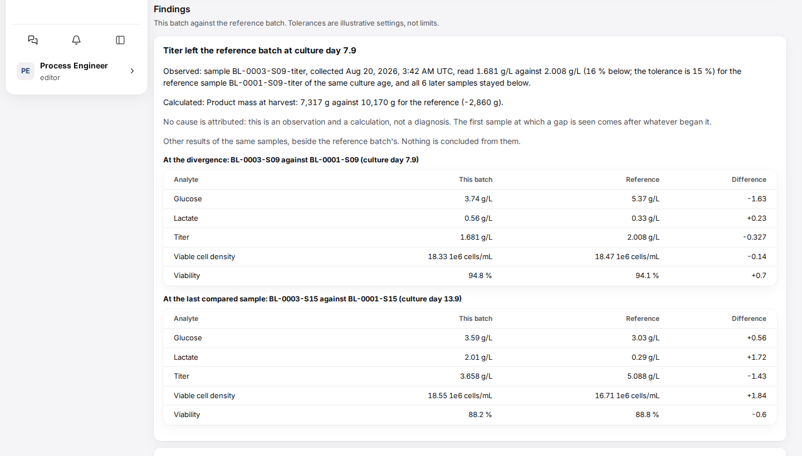
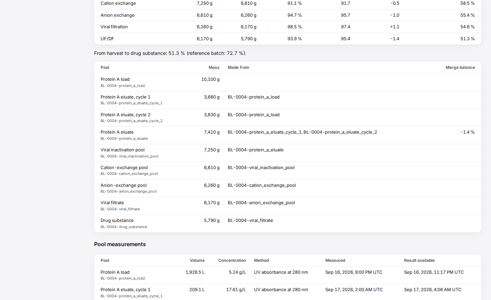
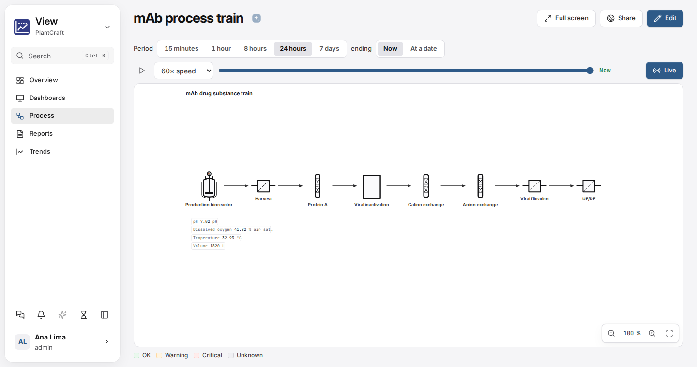
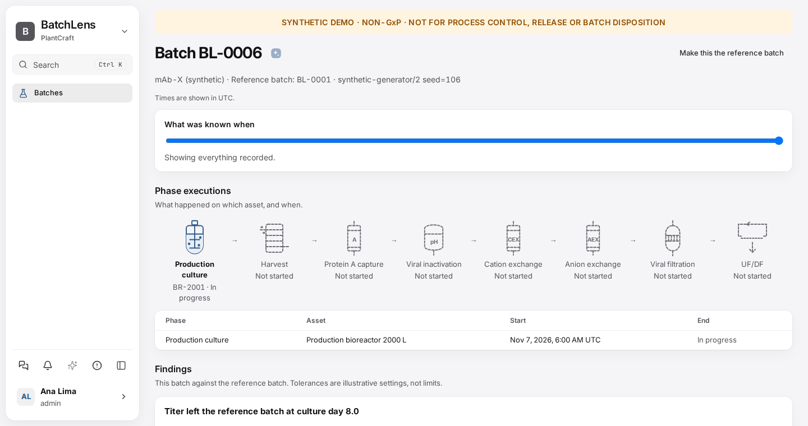

<p align="center"></p>

# BatchLens

**Synthetic data · simulated batches · not for process control, release or batch disposition.**

*Why did this batch yield less recoverable antibody than comparable batches?*

BatchLens is a demonstration of batch-aware analytics for monoclonal antibody (mAb)
manufacturing. It joins what usually sits in separate systems (batch phases, online plant
signals, offline assay results, pool measurements) and follows the product through one chain:

```
VCD samples -> IVCD -> specific productivity -> harvest titer x bioreactor volume
            -> product mass at harvest -> mass loaded on Protein A -> mass eluted
            -> viral inactivation -> polishing -> viral filtration -> UF/DF -> drug substance
```

For each batch it says where that chain left the reference batch, what that cost in grams, and
which records the statement rests on. It attributes no cause, and when the records do not
support a number it says so instead of producing one.



The purification train of the batch with the poor capture step, and its pool genealogy:



## What it shows

Seven batches of one campaign on one 2,000 L bioreactor. Six are finished, each followed by
harvest and the purification train; the seventh is running now. Three normal batches of the
campaign before (`BK-0007` to `BK-0009`) are kept to compare with:

| Batch | What happened | What the app says |
|---|---|---|
| `BL-0001` | Normal; the reference | Its own numbers |
| `BL-0002` | Normal | Within every tolerance |
| `BL-0003` | Specific productivity fell from day 7 | Titer left the reference at culture day 7.9; 7,317 g against 10,170 g at harvest |
| `BL-0004` | Normal culture, poor Protein A step: its elution buffer lot was made at pH 3.9 for 3.5 | Recovery 20 points below the reference; 7,410 g against 9,230 g in the eluate; beside it, the buffer lot at pH 3.94 against the reference's 3.49 |
| `BL-0005` | Normal culture, **bad records** | Culture metrics `invalid`, harvest mass `insufficient`, each naming the record it tripped on |
| `BL-0006` | Slow last seed passage: the culture began with too few cells | The culture began 61 % below the reference's density; 9,392 g against 10,170 g at harvest, at a normal productivity per cell |
| `BL-0007` | **Running now**, nine days into its culture when the demo starts; productivity fell from day 7 | Titer left the reference at culture day 8.0; nothing about harvest yet, because it has not happened |

The left column is the generator's ground truth. The app never sees it: it lives in the
generator's separate output, the tests, the benchmark and the documents.

## Inside the PlantCraft suite

BatchLens is an app for [PlantCraft](https://github.com/PlantCraft/PlantCraft), an open
industrial data suite, and the demo runs it beside the suite's own modules on one synthetic
plant. The bioreactor's signals are live: the same values BatchLens reads for the running
batch are archived in PlantCraft Historian, checked by PlantCraft Analytics' Signal quality
monitor (which also judges the bioreactor's three control loops), on a dashboard and a process display in PlantCraft View and under alarm rules in
PlantCraft Alarms, and the reports of this repository are in PlantCraft Documents, linked to
the plant's assets.





BatchLens tells PlantCraft one thing on its own: an event on an asset while a batch's phase is
running on it (`docs/demo.md`, "What BatchLens tells PlantCraft"). Everything else it reads.

## What makes it more than a dashboard

- **A batch is a window on shared equipment.** The same four bioreactor signals carry every
  batch; each read is scoped to a phase execution's asset and time window.
- **Collection time is not availability time.** A titer sampled on day 6 and reported on day 7
  cannot be used in an analysis "as of" the evening of day 6. Every route takes `as_of`.
- **Every number carries its status, reasons and inputs.** `usable`, `suspect`, `insufficient`
  or `invalid`, with the ids of the results and signals it was computed from, and a
  calculation version. Units are exact strings and are never converted.
- **It knows when it cannot answer.** A missing asset, a hole in the historian, a mis-keyed
  timestamp: the metric says what was missing. Nothing is interpolated across a gap,
  extrapolated or clipped.
- **Findings keep observation, consequence and cause apart**, and the cause is always empty.
- **The mass balance runs to drug substance.** Each purification step has its yield beside the
  reference's and what is left of the harvest; pools that were merged are checked against
  the sum of their parts.
- **An assistant can read it, on the same terms.** Two read-only tools give PlantCraft's
  assistant the same numbers as the page, with statuses and reasons, and tell it that no cause
  is attributed.
- **It is measured.** [docs/verification-report.md](docs/verification-report.md) scores the
  findings against ground truth over 380 seeded batches: at the default tolerances, no false
  alarms in 700 comparisons of the titer or 7,700 of the later steps, 99 % of strong falls in
  productivity found with a median delay of about two days, mild ones mostly missed, and no
  number ever returned for a badly recorded batch.

## Run it

```sh
uv venv --seed --python 3.12 ~/.venvs/batchlens
export PATH="$HOME/.venvs/batchlens/bin:$PATH"
make ci                    # app standard, translations, lint, interface build and tests, pytest
tools/run_demo.sh          # PlantCraft, its modules, BatchLens and the plant, at http://127.0.0.1:8088
```

`tools/run_demo.sh` needs a PlantCraft checkout beside this folder; [docs/demo.md](docs/demo.md)
has the one-time setup, a tour to follow, and what each batch contains. `make ci`
alone needs no PlantCraft: the tests run against the SDK's fake.

## What it is, and is not

- **Independent.** A personal portfolio project. It is not written, reviewed or endorsed by the
  PlantCraft maintainers. It is built on [PlantCraft](https://github.com/PlantCraft/PlantCraft)'s
  Apache-2.0 app template and SDK and keeps their licence notices ([LICENSE](LICENSE),
  [ATTRIBUTION.md](ATTRIBUTION.md)). It is called BatchLens; its manifest name is `BatchLensCraft` (id
  `batchlens`), the only form PlantCraft's SDK accepts for an app outside the suite. The
  PlantCraft name is kept for the suite's own apps.
- **Synthetic only.** Every batch, sample, signal and tolerance comes from a seeded generator
  with hand-chosen, illustrative parameters. Nothing comes from a real facility, employer or
  client.
- **Not validated.** Not an MES, LIMS or QMS; no release, disposition or control
  decision. The generator is a shape generator, not a mechanistic or validated model.
- **Plant data stays in PlantCraft.** The app keeps batches, phases, samples, assay results and
  pool measurements in its own database, stores only the ids of assets, and reads signals and
  series through PlantCraft's API as the signed-in person. Metrics are computed on request and
  never stored.

## Read more

| | |
|---|---|
| [docs/demo.md](docs/demo.md) | Running it, a tour, the batches |
| [docs/scientific-assumptions.md](docs/scientific-assumptions.md) | Formulas, worked examples, every assumption and setting |
| [docs/verification-report.md](docs/verification-report.md) | The benchmark's results |
| [docs/case-study-engineering.md](docs/case-study-engineering.md) | The design and its tradeoffs |
| [docs/case-study-ai-development.md](docs/case-study-ai-development.md) | How it was built with a coding agent |
| [docs/gaps.md](docs/gaps.md) | What is known to be missing or untested |
| [docs/README.md](docs/README.md) | Every document |

## Where things are

| Path | What it is |
|---|---|
| `src/batchlens/calc/` | The formulas and the result type. Standard library only |
| `src/batchlens/batches/` | The app's object: records, store, service |
| `src/batchlens/demo/` | The seeded generator, the seed loader, the synthetic plant as importable files |
| `src/batchlens/analysis/` | A batch's metrics and findings, assembled from records and the volume signal |
| `src/batchlens/benchmark/` | The findings scored against the generator's ground truth |
| `src/batchlens/api/` | The read routes, and what they read from PlantCraft (`plant.py`) |
| `frontend/src/` | The two pages, on `@plantcraft/ui`, in English and Brazilian Portuguese |
| `tools/` | The one-command demo, its gateway, and the seeding of the suite's modules |
| `tests/` | pytest against the SDK's fake PlantCraft; `tests/e2e/` browser journeys |

## License

Apache-2.0 ([LICENSE](LICENSE)). Third-party assets and libraries: [ATTRIBUTION.md](ATTRIBUTION.md).
